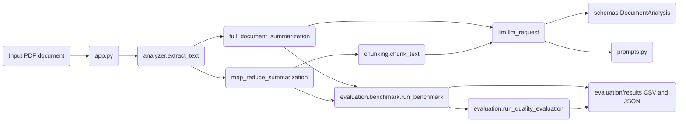

# Full Context vs Map Reduce for Document Summarization

This project compares two summarization methods on a document using an LLM as judge.

Full context sends the entire document to the model in one pass.

Map reduce splits the document into chunks, summarizes each chunk, then merges the results.

The evaluation shows that full context is more precise, keeps context intact, and costs less. Map reduce is slower, costs more, and loses context.

## Benchmark Results

| Approach | Wall Latency Seconds | Input Tokens | Output Tokens | Total Tokens | Estimated Cost USD | Request Count | Chunks Processed |
| --- | ---: | ---: | ---: | ---: | ---: | ---: | ---: |
| Full Context | 30.748 | 17454 | 546 | 18000 | 0.0029457 | 1 | 1 |
| Map Reduce | 113.169 | 24093 | 4783 | 28876 | 0.00648375 | 9 | 8 |

## Architecture

## Quality Evaluation

| Approach | Faithfulness | Completeness | Entity Accuracy | Relevance | Conciseness | Findings |
| --- | ---: | ---: | ---: | ---: | ---: | ---: |
| Full Context | 5 | 5 | 5 | 5 | 5 | 0 |
| Map Reduce | 3 | 4 | 4 | 4 | 3 | 4 |

## Output Files

Benchmark and quality reports are saved in `evaluation/results`.

## Run

Install dependencies with `pip install -r requirements.txt`.

Run the project with `python app.py`.
